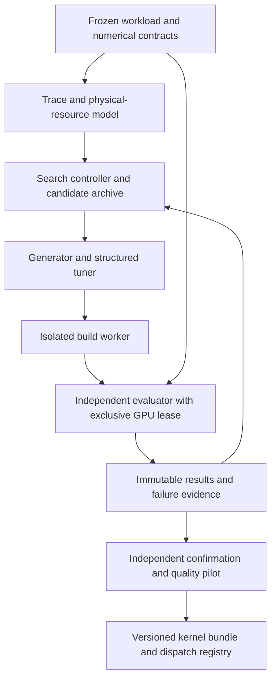

> Historical design specification. See [implementation status](../README.md) for the implemented and unvalidated parts.

# Terminus AutoKernel: training-kernel research system

Design date: September 15, 2026. **Specification only: no search service, kernel campaign, GPU run, or quality certification is implemented by this document.** The companion [original planning contract](planning-contract.json) records the proposed initial contract and unresolved launch prerequisites.

Build a system that discovers faster implementations of this model's training computation, rejects numerical or measurement shortcuts, and retains enough evidence to reproduce every decision. Its primary objective is **quality-qualified, sustained training throughput**. Individual kernel speed is a diagnostic and search signal.

“Cannot be better” is not a defensible guarantee for an open-ended program search. The operational standard is stronger than “we tried many kernels”: compare against competitive implementations, account for the dominant physical resources, explore materially different algorithms, reproduce improvements independently, and publish what remains unexplored. Report **best verified implementation within a declared workload, hardware, numerical contract, and search budget**, never global optimality.

## 1. Starting point and immutable scope

The initial incumbent is [the selected 30-layer configuration](../examples/terminus_config.json). Historical evidence is in the [September 15 report](baseline.md) and its [raw summary](../evidence/baseline_summary.json).

| Property | Initial campaign contract |
| --- | --- |
| Architecture | 30 layers; 1,502,210,108 parameters; width 2,048; SwiGLU width 5,376 |
| Vocabulary and context | 96,000 vocabulary entries; 4,096-token context; tied embedding/head |
| Attention | 16 query heads; 4 KV heads; head dimension 128; existing causal/local/global masks, RoPE and QK normalization |
| Attention schedule | Existing 1,024 local window; global attention every fifth layer |
| Numerical policy | Existing ternary mapping, independent FP8 operand orientations, block scaling, BF16 rounding/residual policy, FP32 latent weights and optimizer state |
| Training objective | Full-vocabulary cross entropy; all valid token and parameter gradients; existing STE and loss normalization |
| Update semantics | AdamW, parameter groups, clipping, schedules, weight-cache invalidation and token accounting preserved |
| Single-GPU timing workload | 32,768 tokens/update; batch 8 × accumulation 1 primary; batch 4 × accumulation 2 secondary |
| Initial hardware | One H100 NVL, 400 W; exact device UUID, memory capacity and runtime discovered and recorded at launch |
| Historical incumbent | 43,922 tokens/s; 746.04 ms/update; 80.05 GB peak allocated, 80.90 GB reserved |
| Target | 67,000 tokens/s; 489.07 ms/update; another 256.97 ms/update to remove |

Freeze the **resolved** model/training/optimizer configurations, including default values omitted from the JSON. Preserve 30 layers throughout this campaign; the user's 20-layer minimum is not a reason to search smaller architectures. No pruning, narrower vocabulary, shorter context, attention approximation, gradient filtering, new FP8 scale granularity, reduced optimizer precision, or changed token mixture enters this search space.

Microbatch scheduling and activation recomputation may be searched only with the same update tokens, objective and gradient semantics. Recomputed work and any extra cache traffic belong in the measured update. No runtime hyperparameter tuning is hidden inside kernel tuning.

Separate three claims:

1. **Implementation improvement:** equivalent implementation of the existing FP8 training policy.
2. **Training-quality qualification:** evidence that the selected implementation preserves real-data quality. The existing FP8 policy itself still lacks equal-token multilingual quality validation.
3. **Production target:** useful tokens per wall-clock second under actual data, communication, evaluation, checkpoint and recovery costs.

The historical 43.9k result supports the first campaign's baseline only. It does not establish the second or third claim.

## 2. Research basis and build-versus-reuse decision

Primary sources were read on September 15, 2026. Repository links below pin the inspected revision where available. These are design inputs, not adopted execution instructions or independently reproduced performance results.

| Source | Useful mechanism | Decision for Terminus |
| --- | --- | --- |
| [RightNow-AI AutoKernel][autokernel] | Profile → extract → edit → fixed evaluation → keep/revert; Amdahl-based prioritization; staged checks | Adopt the research loop. Its inspected verifier uses `model.eval()` and `torch.no_grad()`, so it does not certify our training backward/optimizer contract. Do not use it unchanged as the judge. |
| [Meta KernelAgent][kernelagent] | Hardware-counter feedback, subgraph composition, beam search and a recorded candidate history | Adopt diverse search branches and hardware-guided diagnosis. Do not treat a high utilization counter or its documented 95% SOL stop rule as proof of optimality. |
| [KernelBench][kernelbench] and [evaluation notes][kernelbench-eval] | Reference programs, randomized correctness, multiple timing modes, adversarial evaluator tests | Reuse evaluation ideas and selected tests. Training-specific fixtures and an independent judge are still required. Its evaluation notes explicitly document cached-output, input-mutation and stream timing exploits. |
| [Triton autotuning][triton-autotune] | Structured tile/warp/stage search, pruning and state-reset hooks | Use as an inner parameter-search mechanism. Its documentation warns that autotuning reruns kernels and can repeatedly mutate inputs; all mutable state must be restored. |
| [NVIDIA Hopper tuning guide][hopper] and [CUTLASS][cutlass] | TMA, warp specialization, shared-memory layouts and architecture-specific GEMM building blocks | Support Hopper-specific CUDA/CUTLASS alongside Triton when a measured bottleneck justifies it. Test feature/toolchain support instead of assuming Blackwell features exist on H100. |
| [DeepGEMM][deepgemm] | Competitive block-scaled GEMMs and native gradient paths | Keep the pinned implementation as an incumbent. Evaluate library/compiler revisions as whole-runtime candidates with fresh controls. Current upstream requires a newer toolkit than our recorded runtime; no silent upgrade. |
| [FlashAttention-3][fa3] | Hopper attention forward/backward and asynchronous execution | Keep BF16 FA3 as the attention incumbent. An FP8 forward benchmark is not a substitute for our BF16 training attention contract. |
| [Cut Cross-Entropy][cce] | Full-vocabulary loss without retaining a full logits matrix; explicit unfiltered variants | Evaluate ideas or compatible implementations with **both gradient filters disabled** and adequate accumulation. The default filtering policy is outside this campaign. Its “exact” name alone does not establish our rounding/gradient compatibility. |
| [Nsight Compute][ncu] and [Compute Sanitizer][sanitizer] | Resource diagnosis, replay controls, memory/race/synchronization checks | Integrate as separate diagnostic/correctness stages. Profiled replay time is not throughput evidence; passing sanitizers is not a proof of correctness. |

**Recommendation:** implement a small Terminus-owned controller and evaluator, with adapters to these tools and libraries. Do not fork an entire agent framework into the training runtime. Start with one generator and one exclusive GPU evaluator; multiple proposal workers can be added later without changing the judging contract. This document does not launch any agents.

## 3. Architecture and authority boundaries



| Component | Responsibility | Must not control |
| --- | --- | --- |
| Contract registry | Equations, dtypes, shapes, numerical gates, update workload, data identities | Candidate-specific exceptions invented after a failure |
| Trace adapter | Shapes, strides, call counts, lifetimes, saved tensors, forward/backward dependencies | Training equations or token counts |
| Search controller | Allocate budget, select hypotheses, maintain diverse candidates and failure history | Rewrite evaluator thresholds to reward a candidate |
| Generator/tuner | Propose device code and supported launch/layout choices | Judge, reference, holdout cases, telemetry, release status |
| Build worker | Compile in a pinned toolchain; emit artifacts, diagnostics, resource use and ABI | Cloud credentials, production data, GPU power settings |
| GPU executor | Run trusted launch adapters against candidate artifacts under a device lease | Select its own score, omit tests or self-report a pass |
| Judge | Compare independently computed expected tensors; own timing and acceptance decisions | Search patch contents |
| Confirmation service | Rebuild and evaluate a frozen shortlist on reserved workloads | Continue tuning against confirmation results in the same round |
| Bundle registry | Publish exact kernel/dispatch/runtime combinations with compatibility manifests | Replace a running training implementation silently |

The default trust boundary is a **compiled device artifact plus a constrained launch manifest**. Arbitrary generated Python must not be imported into the judge process: it could change timers, references or comparisons. Triton source may execute during compilation, so compilation occurs in an unprivileged isolated worker. The trusted runner owns tensor allocation, pointer arguments, workspace, synchronization, output collection and supported library calls. Prototype this artifact/ABI boundary before scaling search; if a backend requires unrestricted candidate Python in the judge, it is not eligible for automatic promotion.

A launch manifest may specify approved entrypoints, validated shape/stride-based dispatch, grid/block dimensions, workspace and a bounded sequence of launches. It cannot specify arbitrary host code, subprocesses, network calls, reference invocations, runtime-mode detection or timing logic. The initial supported fusion graphs use trusted adapters; genuinely new adapter semantics require a separately versioned evaluator change and fresh controls.

The supervisor and reference process run outside the candidate sandbox, with separate credentials and writable storage. Use restricted mounts, no network, process/resource limits and no inherited Azure/LLM credentials. Holdout tensor values and reference outputs are never included in generator prompts or mounted in its workspace. Device inputs necessarily reach the kernel; hidden seeds are one defense, not secrecy-based proof. Exercise changing inputs, poisoned outputs and independent address allocations to expose input-specific or stale-output tricks.

Only the supervisor commits results. Hashes detect identity/corruption; access controls and a supervisor-held signing key establish who issued a receipt. Candidate stdout containing `PASS` is diagnostic text, never authority. Native GPU execution remains a fault domain: a driver-level failure quarantines the device; it is not handled by trusting the failed process to recover.

## 4. Concrete contracts and storage

Use a Python control plane, a local single-writer SQLite database for scheduling, and content-addressed artifact directories. Keep the database on a filesystem with supported locking semantics, not an arbitrary network mount. Large traces/tensors live outside the database. A later multi-host service can replace the queue without changing receipt schemas.

| Record | Required fields |
| --- | --- |
| `CampaignSpec` | Schema version; resolved semantic contract; source snapshot; incumbent bundle; target device/runtime; workload families; fixed gate policies; budgets; data/quality prerequisites |
| `TaskSpec` | Operation/subgraph; forward and backward equations; tensor shapes/strides/dtypes/alignment; aliases; mutation rules; outputs/saved state; call frequency; independent oracle and numerical-policy digests |
| `CandidateSpec` | Parent IDs; hypothesis; expected saved work; source/patch hash; backend; launch manifest; workspace; dependency versions; declared shape guard; legal fallback |
| `EvaluationReceipt` | Candidate, task, judge, oracle and policy hashes; compile/binary hashes; device/runtime/power identity; gate states; raw samples; observed failures; telemetry; resource use; supervisor signature |
| `PromotionRecord` | Frozen candidate set; incumbent; comparison protocol; confidence intervals; quality status; supported shape envelope; restrictions; exact dependencies and rollback bundle |

Canonical IDs hash all semantic inputs, not just a kernel filename. Include adapter code, nested Python modules, C++/CUDA headers, compiler flags, cubins/PTX, relevant environment variables and launch settings. The existing `source_hashes()` only scans top-level `terminus/*.py`; it must be extended before nesting framework or kernel code under new packages. Package version strings alone do not identify a local build. Capture the dirty working-tree snapshot explicitly when there is no committed revision.

Cache keys include architecture, runtime/compiler, input layout and alignment, numerical policy, input/output dtypes, accumulation behavior and shape parameters. Weight-cache identity additionally includes parameter storage/version and optimizer-update epoch. Reject a cache entry after a mismatched mutation, reload, dtype/device move or runtime change.

Proposed interfaces, to implement later:

```python
freeze_campaign(spec) -> FrozenCampaign
extract_tasks(frozen_campaign, diagnostic_trace) -> list[TaskSpec]
propose(task, incumbent, observations, remaining_budget) -> CandidateSpec
compile_candidate(candidate, pinned_toolchain) -> ArtifactBundle
evaluate(artifact, task, gate_policy, device_lease) -> EvaluationReceipt
confirm(frozen_shortlist, reserved_protocol) -> ConfirmationReport
qualify_quality(bundle, paired_training_protocol) -> QualityReport
export_bundle(confirmation, quality, compatibility) -> KernelBundle
```

No generator-facing function accepts a replacement score or a “skip failed gate” field. All metrics use explicit units and nullable values: unsupported counter collection is `unavailable`, never a fabricated zero or a passing result.

## 5. Search policy: different algorithms before endless parameter sweeps

The outer search explores **computation schedules and fusion boundaries**. The inner search tunes legal implementations. Keeping only the fastest single kernel creates local traps; keep a small archive of materially different families and a Pareto set for latency, memory, numerical margin, compile cost and integration compatibility. Quality gates are hard constraints, not a weighted term that speed can offset.

Initial outer families:

- Producer/consumer fusion: normalization, activation and quantization; backward producers with packed gradient/quantization output.
- FP8 operand layout and data movement: row/column generation, transposes, scale writes, TMA-compatible storage.
- GEMM schedules: existing library paths, persistent or conventional tiling, pipeline stages, warp specialization, legal split-K and deterministic reductions.
- Full-vocabulary loss schedules: token/vocabulary tiling, on-chip reductions, recomputation versus retained intermediates, classifier-gradient accumulation.
- Memory lifetime and reuse: saved-state reduction, allocation reuse, recomputation and cache refresh scheduling.
- Host scheduling: launch batching, graph capture where valid, descriptor/workspace reuse, CPU dispatch reduction.
- Runtime alternatives: pinned compiler/library bundles; tracked as separate experiments rather than changing software beneath a comparison.

Initial inner dimensions include tile M/N/K, warps, stages, shared-memory layout, register pressure, vector widths, CTA swizzle, grouped launches, legal cluster dimensions and split count. Static checks prune unsupported instructions, shape misalignment, impossible shared-memory footprints, invalid scale grouping and excessive workspace. Compiler/resource measurements, not only source estimates, determine final feasibility.

Use constrained enumeration for small spaces, then a cost model or Bayesian search when sufficient observations exist. The cost model predicts **measured subgraph time and uncertainty** using shape, resource and compiler features; it does not judge correctness. Deduplicate source/parameter combinations and retain failed compiles, OOMs, numerical failures and slow results. Revisit a failed family only with a stated changed assumption, such as a different schedule, compiler or integration boundary.

Each proposal must state:

1. Which measured bottleneck it addresses and on which shapes.
2. Which bytes, launches, dependencies or arithmetic it removes or overlaps.
3. Its numerical and state-lifetime obligations.
4. Its optimistic maximum update-level saving and likely integration costs.
5. The falsifying experiment and bounded compile/evaluation budget.

Prioritize roughly by `probability_of_passing × plausible_update_ms_saved / evaluation_cost`, with explicit uncertainty and some reserved budget for new families. This is a scheduling heuristic, not a scientific performance estimate. Start with a 60% exploitation / 25% alternative-family / 15% interaction-and-revisit allocation within the search budget; revise it only between recorded rounds. Confirmation and quality budgets are reserved separately.

After a verified gain, refresh the whole-update profile. A 2× isolated speedup of a region consuming 5% of update time can save at most roughly 2.5% before integration costs. Conversely, a locally slower quantizer can enable a faster consumer layout. Judge coupled changes at their complete subgraph boundary.

Evaluate complementary candidates together, then ablate each contribution against the same incumbent. Do not add isolated speedups or sum timings of overlapping/nested regions. Preserve an unfused/library branch when fusion increases registers, live memory, synchronization or power enough to erase its traffic saving.

## 6. Initial workload registry and optimization backlog

Derive the registry from real calls and retain call-frequency weights. The following shapes are the seed set, not an exhaustive generated list:

| Family | Required coverage |
| --- | --- |
| Projections | QKV `(out=3072, in=2048)`; output `(2048,2048)`; gate/up `(10752,2048)`; down `(2048,5376)`; all forward/dgrad/wgrad orientations |
| Token dimensions | Production rows 4,096, 8,192, 16,384, 32,768 where scheduling permits; tiny/tail rows such as 1, 7, 127, 128, 129, 257 for supported adapters |
| MLP/normalization | Packed gate/up; scalar and channel gains; all relevant widths; forward and complete parameter/input gradients |
| Attention | Actual head counts and dimension; local/global causal cases; window boundaries; strided gradients; inference/cache guards if adapters are shared |
| Loss | V=96,000, D=2,048; partial chunks; ignored labels; all-ignored semantics; tied-head gradient; upstream loss scales; 64-bit addressing |
| State | Accumulation 1/2/4/8 at fixed update tokens; optimizer/cache epochs; repeated graph replay if enabled; checkpoint reload |

Cases outside the optimized shape envelope take an explicitly tested incumbent path. A shape guard is legitimate; recognizing a benchmark seed, tensor contents, warmup phase or number of prior calls is not.

One separate diagnostic update measured approximately 306 ms of projection GEMMs, 89 ms of activation/gradient quantization, 101 ms of attention, and 85 ms of head/loss work. These CUDA-event regions include host gaps and are not the pooled 746 ms timing or achieved hardware bandwidth. Obtain fresh trace/counter evidence before assigning precise saving budgets.

| Priority | Hypothesis and first experiment | Required protection / rejection condition |
| --- | --- | --- |
| P0 | Establish trusted evaluator, A/A noise calibration, shape registry and complete-update trace | Search does not begin before a known-wrong kernel is reliably rejected and an unchanged candidate is not falsely promoted |
| P1 | Fuse norm/MLP output production with rowwise FP8 quantization, then study the independent transposed orientation | Preserve BF16 rounding before scale selection. Column-oriented groups span token rows; a row-local producer cannot silently reuse row scales. Time all remaining orientation passes and saved backward state |
| P1 | Emit packed backward gradients and compatible quantized operands directly from MLP/QKV/norm backward where possible | Every required gradient and both FP8 orientations must exist; removing an intermediate must not force a more expensive reread or change tiny-gradient behavior |
| P1 | Tune dominant GEMMs using native DeepGEMM/CUTLASS Hopper schedules, including wgrad | Keep per-128 scale application and required accumulator precision. Prior generic Triton split-K was slower; a retry needs a new hardware-level reason, not merely more split counts |
| P1 | Compare exact/unfiltered full-vocabulary loss schedules against the existing streaming implementation | Include head forward, dHidden, FP32 dWeight, normalization, tied embedding accumulation and all workspace. No sampled softmax or filtered derivatives; existing code already avoids retaining full-batch logits |
| P2 | Tune FA3 local/global backward and explore adjacent layout fusion | Preserve masks, QK normalization and BF16 attention arithmetic. Validate asynchronous hazards and resource pressure. Generic FlexAttention previously lost; use that as negative evidence |
| P2 | Fuse compatible residual/normalization boundaries and reduce saved-state/materialization traffic | Preserve residual BF16 rounding and both gradient branches; measure the whole block rather than adding nominal memory savings |
| P2 | Integrate weight conversion/cache writes with optimizer epilogues where legal | Global clipping must finish first; both tied-head gradient contributions must arrive; preserve AdamW groups, bias correction, state precision and parameter versions. Baseline already uses fused AdamW |
| P3 | Revisit graph/launch scheduling and allocation reuse after kernel changes | Previous graphs did not improve throughput. Count replay, refresh, private pools and graph-capture state; retain eager fallback |

SubLN, QK normalization and the 96k head may look expensive at 1.5B parameters, but removing them changes the model. This framework first removes their implementation overhead, not their mathematical role.

## 7. Numerical correctness: independent equations, gradients and state

Maintain two separate reference levels:

- **Implementation oracle:** frozen equations for the existing FP8/BF16 policy, including rounding boundaries, independently oriented scale groups, clipping, STE and accumulation dtypes. It must not call a quantizer or helper being optimized by the candidate.
- **Higher-precision reference:** FP32/FP64 computations where practical, to measure the underlying approximation and accumulation error. Use small/selected cases for expensive FP64 products, plus tiled full-size checks where necessary. A sampled check does not replace full-output comparison on supported production shapes.

The current preflight is useful seed material, not a complete independent judge. For example, `reference_linear()` uses quantization helpers from the same package, and reduced-model checks do not cover full-size optimizer state. Isolate the oracle and expand coverage before relying on it for open-ended generation.

Pre-register per-operator numerical policies using equations, required exact invariants, dtype rounding analysis and baseline-versus-oracle calibration. Do not apply a generic `rtol=1e-2` to everything. Existing broad FP8 approximation bounds are ceilings on an already approximate policy, not a fresh error budget each new kernel can consume. A candidate must meet absolute gates **and** the frozen baseline-relative envelope.

Required metrics include maximum absolute error, normalized L2 error with meaningful zero handling, per-row/per-channel error, tail quantiles and gradient direction where defined. Report worst cases, not only tensor-wide averages. Exact-zero expected outputs use exactness or a separately justified absolute bound; small expected norms must not be hidden by a convenient denominator floor. Keep exact code/scale equality for quantizer rewrites where the contract demands it. New reduction schedules need a declared accumulation envelope, not an automatic relaxation.

The test matrix must exercise:

- Forward values; input, weight, norm-gain and tied-head gradients; loss upstream multipliers; repeated accumulation.
- Zero/tiny gradients including approximately `1e-12`; cancellation; wide per-token magnitudes; outliers; saturation and quantization thresholds; constant inputs; signed zero where relevant.
- Nonfinite inputs and the established nonfinite behavior. No silent replacement of NaNs/Infs to make a test or optimizer update appear healthy.
- Shape tails, noncontiguous/strided/broadcast gradients, unused outputs, storage offsets, legal aliasing and read-only input mutation checks.
- Packed QKV/MLP gradient placement; local-window boundaries; causal offsets; all supported scalar/channel gains.
- Loss ignore-index behavior, all-ignored targets, partial chunks, upstream scaling and every head/embedding gradient contribution.
- Large-index cases crossing `2^31` element offsets; the previous 32,768 × 96,000 logits bug is a permanent regression fixture. Budget the actual allocation or validate an equivalent supported addressing path; do not label a tiny-only test as large-index coverage.
- Fresh parameter/cache versions after updates, checkpoint loads and graph replays; no stale quantized weight reuse.
- Determinism and race sensitivity across repeated runs, allocator poisoning and different legal launch orders. If an incumbent operation is nondeterministic, freeze a bounded policy explicitly; do not demand blanket bitwise equality or introduce new nondeterministic accumulation casually.

For smooth portions use directional derivative tests and, on small tensors, finite differences. **Do not finite-difference the quantized forward and expect it to reproduce an STE backward.** Check the specified surrogate-gradient equations directly. Respect existing first-order-only loss/autograd behavior; unsupported higher-order derivatives must fail explicitly rather than return plausible wrong values.

Run `memcheck`, `initcheck`, `racecheck` and `synccheck` on shortlisted custom kernels and supported launch paths, with nonzero error exit codes. Include Hopper WGMMA/TMA checks when supported by the pinned tool. Racecheck primarily covers shared-memory hazards; use algorithm review, output poisoning and repeated stress tests for hazards it does not detect. Unsupported sanitizer coverage is recorded and cannot silently satisfy a required release gate.

Before performance confirmation, compare a complete 30-layer update from identical model, optimizer, RNG, cache and input state. Check loss, all parameter gradients, pre-clip norm, clip coefficient, updated parameters, Adam moments and update counters. Continue through multiple changing-input updates; a single finite loss is not sufficient. Test pause/checkpoint/reload/resume and all advertised accumulation modes. Memory may require sequential execution and host-staged reference tensors; account for validator cost separately from training throughput.

## 8. Measurements that withstand a long search

### Timing scopes

Keep three explicit measurement types:

1. **Kernel:** device execution latency for a declared operation and input/layout/cache condition.
2. **Subgraph:** all producers, consumers, conversions, workspace initialization and required synchronization at a legal replacement boundary.
3. **Training:** complete forward/backward/clipping/optimizer/cache-refresh updates, including CPU dispatch and required synchronization. Final decisions use this scope.

For training, use judge-owned host elapsed time with device completion verified on both boundaries. For permitted multi-stream work, all stream dependencies must join before completion; a start/end event on the default stream alone is insufficient. A trusted launch adapter controls streams. Compare host and device measurements for suspicious gaps. Profilers and sanitizers run separately.

Restore mutable inputs, outputs, gradients and optimizer state between comparative trials. Triton autotuning must use correct reset/restore behavior, including workspaces and accumulation outputs. Do not reset production state inside timed updates unless production actually does that reset. Account for legitimate zeroing and cache invalidation inside the workload.

Compile, autotune and allocate long-lived buffers before steady-state timing. Record their one-time cost separately. Use both fixed-input microbenchmarks and rotating inputs/addresses reflecting the training working set; a tiny L2-hot test cannot stand in for HBM traffic through 30 layers. Include persistent allocator/graph-pool reservations and process-level GPU memory, not just live tensor allocations. No CPU offload unless the full transfer/lifetime cost is included and it fits the frozen execution contract.

Freeze a memory budget after measuring the actual device's usable capacity. Reserve headroom for allocator variability, the real data pipeline, evaluation/checkpoint peaks and communication buffers in the applicable workload. An allocation that barely fits a synthetic update does not pass the production memory gate. NVL and 80 GB SXM configurations need separate fit checks and may require different microbatch schedules; never infer fit from the shared H100 name. Unknown workspace bounds block automatic promotion.

### Exclusive hardware and environmental controls

The controller owns a renewable lease for a **specific GPU UUID**, with one active timing worker. CPU generation and compilation may overlap each other, but throttle compilation during final timing if it changes CPU availability or thermals. No simultaneous benchmark, profiler or sanitizer runs on the same GPU. Prevent a lease from being reused until the previous process tree is confirmed stopped.

Record GPU SKU, UUID, SM count, usable memory, driver/toolkit/library/compiler identities, MIG/MPS state, CPU/thread/affinity settings, power limit, sampled power/clocks/temperature and other GPU processes. Use a warmup until timings and thermals stabilize under a predeclared rule with a timeout; five updates alone are not assumed sufficient. Hardware power capping is normal for this device and must not be filtered away.

Do not “correct” measured speed by multiplying by advertised/observed clocks. Do not reject a candidate's reproducible lower clocks when its workload itself causes them. Reject/repeat a pair only for a predeclared environmental fault such as unrelated GPU activity, driver errors or a changed power policy. Record all discarded observations and reasons. Unsupported clock controls remain unsupported; issuing a command is not evidence the requested setting took effect.

### Selection and confirmation statistics

Start with A/A trials: run the unchanged incumbent through both arms of the proposed evaluator. They estimate between-run variation, temporal drift and false wins; exact injected delays and intentionally wrong kernels test sensitivity and correctness. Choose block counts from this calibration before looking at candidate performance.

Search measurements are inexpensive and exploratory. They may rank candidates but cannot certify an improvement. Reserve a small frozen shortlist, then run independent confirmation:

- Randomized balanced control/candidate order, including ABBA/BAAB blocks, with identical starting states and input sequences per paired block. Record every order and seed.
- Suggested floor: eight paired blocks across at least two separately initialized sessions, each with at least 128 measured updates per arm after stabilization. Increase the predeclared sample size if A/A variability requires it; the floor is not a precision guarantee.
- Compute pooled throughput as total valid training tokens divided by total measured seconds. Do not average per-step tokens/s or report the best run as the estimate.
- Estimate the candidate/control elapsed-time ratio using paired block-level resampling or a justified paired model. Preserve correlation within blocks; hundreds of steps from one run are not hundreds of independent replicates. Report uncertainty and session variation.
- Predeclare a practical promotion threshold, initially 1% full-update speed improvement. A performance promotion needs the adjusted confidence bound to clear that threshold, not merely a favorable point estimate. A memory-only improvement may enter the Pareto archive under a separate predeclared no-regression margin; it is not counted as throughput progress.
- Control repeated comparisons. For confirmation round `j >= 1`, allocate error probability `0.01 / (j * (j + 1))`; its sum is at most 0.01. Within a frozen shortlist use simultaneous/Bonferroni confidence bounds or another predeclared familywise method. Do not repeatedly inspect ordinary 99% intervals and stop when one passes. Exploratory scores carry no inferential claim.
- Insufficient precision yields `inconclusive`, not `passed`. Once confirmation results influence another code change, that new candidate needs a fresh reserved round.

Calibrate the interval method with A/A data and simulated timing series containing autocorrelation and drift. Allocate adequate independent blocks for the requested tail probability; a large bootstrap sample count cannot compensate for only a few independent observations. The 1% speedup threshold corresponds to a time ratio below `1 / 1.01`, not an interchangeable 1% time-reduction threshold. For the absolute 67k claim, also construct a session-aware interval on pooled candidate throughput; a ratio interval against the incumbent alone does not establish an absolute throughput floor.

Report both the primary batch-8 path and the batch-4 accumulation path. Promotion may specialize dispatch by shape when each supported path passes its own numerical and performance contract. Repeat confirmation after composing candidates; individually confirmed components do not automatically certify their combination.

Historical receipts remain historical. Re-establish a contemporaneous incumbent after a compiler, dependency, host or GPU change. Never compare an upgraded candidate against only an old runtime's saved number.

## 9. Training-quality qualification

Numerical checks catch implementation mistakes; real-data training checks investigate accumulated behavior. They cannot prove zero quality loss for all future tokens. Preserve architecture and objective while making the remaining uncertainty explicit.

Use two comparisons:

| Comparison | Purpose |
| --- | --- |
| Candidate FP8 versus frozen incumbent FP8 | Isolate the impact of implementation changes |
| Existing FP8 policy versus the designated higher-precision training reference | Investigate the still-unqualified FP8 policy itself; this cannot be silently assumed from operator tests |

Run matched pilots from identical starting checkpoints, optimizer states, token streams and schedules with paired seeds. Measure at equal **useful tokens**, not equal elapsed time. Evaluation data and tokenizer are frozen and held out from both training and search. Cover English and all ten supported Indic languages; a weighted aggregate must not hide a language-specific regression.

Before opening candidate results, establish a quality policy containing:

- Per-language token-weighted validation NLL, confidence intervals and document-level evaluation units; do not treat correlated tokens as independent samples.
- A predeclared noninferiority margin for each required metric, expressed in meaningful units, plus a multiple-comparison policy. A margin is the detection/decision tolerance, not permission to deliberately degrade the model. **Margins are unresolved here**, rather than fabricated as proof of “no compromise.”
- Training diagnostics: loss curves, gradient norms, clipping frequency, FP8 scale/saturation statistics, nonfinite events and update/state drift.
- Predeclared checkpoints spanning relevant numerical regimes, including later training states where available. A short startup run with different warmup is not a substitute for the production schedule.
- Seed count and pilot-token horizon justified by baseline variance and required sensitivity. Begin with a minimum of three paired seeds as a planning floor; increase or return inconclusive if power is insufficient. No fixed short pilot automatically qualifies quality.
- Existing downstream/native-language evaluation requirements, if available, with matched checkpoints and an independent final holdout.

Require the upper confidence bound on candidate-minus-reference loss to remain within each registered noninferiority margin. “No statistically significant difference” is not a passing equivalence result. Track absolute reference quality too: matching an inadequate baseline is not proof of acceptable model quality.

If production-quality data, appropriate checkpoints, margins or adequate pilot budget are unavailable, the bundle remains `quality_pending`. The controller may continue legal kernel research, but must not issue a quality-certified release. Fully byte-equivalent paths can justify reducing some incremental candidate checks under a predeclared policy; they do not qualify the underlying FP8 method automatically.

For production qualification, test the actual data pipeline and distributed setup separately. Count globally useful tokens over job wall time, including the declared evaluation/checkpoint cadence, communication, startup amortization and recovery costs. Report sustained windows and stalls. If the target is per GPU, derive it from the global count without double-counting replicated data; do not multiply single-GPU synthetic speed by device count and label it measured production throughput.

## 10. Physical-resource accounting and the 67k decision

Maintain two distinct references:

1. **Analytical optimistic bounds:** operation counts and minimum compulsory traffic under explicitly stated architecture/algorithm assumptions, using appropriate advertised dense peaks. These help identify impossibility or implausible claims; they are not measured attainable performance.
2. **Empirical reference performance:** calibrated bandwidth/GEMM/launch behavior on the exact 400 W device and runtime. This helps engineering prioritization; it is not a law-of-physics upper bound.

For a kernel, a simple optimistic resource bound is `max(FLOPs / compute_peak, compulsory_HBM_bytes / bandwidth_peak)`, with precision-specific compute resources. Compute and memory can overlap; adding these two terms would be wrong. Tensor sizes are not automatically compulsory HBM traffic: caches, on-chip reuse and changed fusion schedules matter. Count scale tensors, padding, conversions and stores where the implementation requires them, distinguishing actual traffic from the minimum.

For a complete update, combine resource work and the dependency graph rather than blindly summing isolated kernel lower bounds. Track the critical path, shared tensor-core resource demand across BF16/FP8, memory lifetimes and legal overlap. Use measured hardware counters to diagnose excess traffic, spills, low tensor-core issue, barriers and launch gaps. Keep unknown counter coverage explicit when CUPTI/NCU is unavailable; existing event regions remain useful coarse measurements but cannot supply bandwidth or stall data.

Use single-GPU dense peaks. Ternary zeros are not proof of the structured sparsity needed for sparse peak arithmetic, and an NVL pair's advertised total is not one GPU's capacity. H100 NVL, SXM and PCIe are separate hardware cohorts. SM100/Blackwell primitives are not part of an SM90 search space.

The historical advertised compute-only reference is 237.87 ms/update, while the target allows 489.07 ms. It omits substantial non-GEMM work and actual power-constrained behavior. Do not extrapolate the 137.8k compute-only ceiling as attainable training throughput. Busy samples showing the 400 W cap do not prove zero headroom; better schedules can still do less work or use resources more efficiently.

Each round updates a **remaining-time ledger**:

| Entry | Meaning |
| --- | --- |
| Confirmed complete-update time and uncertainty | Current measured position |
| Target time for frozen useful tokens | 489.07 ms at 32,768 tokens/update |
| Confirmed savings versus original and immediate incumbents | Measured gains, with interactions included |
| Region-specific optimistic remaining savings | Conditional estimates with assumptions, never promised gains |
| Unmeasured/blocked hypotheses | Reasons and required evidence |
| Remaining gap | Updated target shortfall; no summation of overlapping promises |

A high NCU utilization value can mean efficiently executing redundant work. Continue considering algorithm/fusion changes even when a particular instruction path appears saturated. Conversely, stop tuning a tiny region when its most optimistic saving cannot materially affect the update target.

Reaching a 67k point estimate is not the finish condition. Require the reserved confirmation protocol's lower throughput confidence bound to meet the target on the declared workload, plus numerical, memory and quality gates. Production has its own wall-clock qualification. If only synthetic training passes, label exactly that result.

## 11. Fault handling, budgets and reproducibility

Every run uses an isolated candidate directory or checkout and a frozen source bundle. Never implement keep/revert with a destructive reset of the user's working tree. Artifacts are immutable; a changed candidate gets a new ID. A failure remains queryable with compiler logs, failing test IDs and minimal reproducers.

Persist scheduling state before launching a child. Use renewable device leases, heartbeats, attempt IDs, process-group cancellation and idempotent state transitions. An interrupted evaluation is incomplete even if its last stdout line was favorable. Restart verifies hashes and runtime identity, checks the device is idle/healthy, then resumes from the last committed result. It does not infer success from a partial file.

| Failure | Required response |
| --- | --- |
| Compile/resource failure | Record backend diagnostics; reject or retry within the task's bounded repair budget |
| Numerical/sanitizer failure | Quarantine candidate; keep minimal reproducer; no performance or release promotion |
| OOM | Record peak/reserved/process memory and shape; terminate worker cleanly; preserve incumbent |
| Timeout or illegal memory access | Kill the process group; invalidate its CUDA context; health-check before re-leasing |
| GPU/driver fault or persistent unhealthy state | Quarantine GPU and stop scheduling; no automatic destructive reset of unrelated work |
| Telemetry/identity mismatch | Invalidate affected comparison; retain observations; rebuild contemporaneous control |
| Missing profiler access | Continue only gates that do not require those counters; label diagnosis incomplete |
| Missing required correctness/quality evidence | Return pending/inconclusive; never convert unavailable to passed |
| Disk-full/receipt write failure | Preserve last committed state; do not promote an artifact without a complete receipt |

Budget LLM usage, compile CPU time/RAM, GPU seconds by stage, disk, retries and maximum concurrent workers explicitly. Suggested first implementation defaults are one GPU worker, a small beam of four distinct families and at most two repair attempts per failed proposal. Timing/compile timeouts are task-specific and calibrated; a large library bootstrap is separately budgeted from incremental kernel compilation.

Reserve confirmation and quality resources before spending the exploration budget. Budgets and an external lease expiry should prevent a stalled controller from leaving paid compute running indefinitely. The candidate has no cloud-management permissions. A future resource controller would need to record the VM's original state and restore it on completion/failure using separately authorized and enforced cleanup. Cloud lifecycle control is not implemented by this repository.

Protect the incumbent throughout search. Dispatch only chooses certified implementations inside their declared shape/runtime guards; otherwise choose the supported incumbent before launching work. After a CUDA fault, do not retry the same partially updated optimizer state under a fallback. Restart from a complete compatible checkpoint in a healthy process.

The repository's resume contract includes source/runtime identity. A new kernel bundle therefore cannot be dropped into an old checkpoint by ignoring hash mismatches. Implement an explicit, audited compatibility/migration path before cross-bundle resume: preserve model/optimizer/RNG/data state, identify old and new contracts, run required numerical checks, and emit a new provenance record. Until that exists, use separate runs and the existing strict resume behavior. Keep the previous bundle/runtime available for rollback; checkpoint schema equality alone does not establish resume compatibility.

## 12. Acceptance states and the implementation sequence

Use independent gate fields rather than one overloaded `success` boolean. The controller may advance a candidate through this lifecycle; all attempted transitions and evidence IDs are recorded.

| State | Evidence required | What it permits |
| --- | --- | --- |
| `proposed` | Valid task/candidate contract and bounded budget | Isolated compilation |
| `compiled` | Valid artifact/ABI/resource checks | Candidate execution under trusted adapters |
| `numerical_pass` | Independent forward/backward/state tests on the required discovery suite | Exploratory micro/subgraph timing |
| `shortlisted` | Useful preliminary result or justified memory/interaction value | Sanitizers and complete-update checks |
| `integration_pass` | Required sanitizers, production-shape tests, complete update/state comparisons | Reserved full-update confirmation |
| `performance_confirmed` | Frozen shortlist, independent paired timing, adjusted uncertainty and no missing required gates | Research incumbent/qualified shape dispatch; no quality claim |
| `quality_qualified` | Registered matched training pilot and all required language/quality gates | Release candidate for the tested quality scope |
| `production_qualified` | Actual workload/topology/IO/soak/recovery checks and required wall-clock target | Production bundle within its measured envelope |
| `rejected`, `inconclusive`, `quarantined` | Typed failure or missing evidence | Diagnosis or a new, separately identified attempt |

A later code, compiler, launch, numerical-policy or supported-shape change invalidates dependent gates according to the manifest. A successful microbenchmark does not advance directly to a release. A manual waiver must not retain the same certification label.

Build in the following order. Each row is a reviewable implementation milestone, not a claim that the work is already built.

| Milestone | Deliverable and repository integration | Exit test |
| --- | --- | --- |
| M0: freeze contracts | Versioned JSON schemas; resolved config snapshot; task/shape inventory; artifact hashes; incumbent import; examples | Reject architecture/token/precision changes and stale identities; reproduce identities from the current dirty tree |
| M1: trustworthy executor | Isolated compiler; constrained compiled-artifact adapters; independent oracle/judge; signed receipts; exclusive device lease | Seeded wrong kernels, fake PASS, input mutation, stale output, hidden-stream completion and harness-edit attempts all fail; fault injection leaves no false receipt |
| M2: calibrated benchmark | Wrap/extend `terminus.benchmark`, `scripts.h100_sweep`, `EventProfile` and runtime telemetry; fixed-token rotating inputs; paired analysis | A/A calibration reports false-win behavior; known delays are detected; token changes/mixed runtime/overlapping GPU jobs are rejected |
| M3: deterministic tuner | One quantization/pointwise family; legal parameter enumeration; resets; compiler cache; immutable failure archive | Repeated and resumed searches reach reproducible results without input/state contamination; a slower correct candidate does not replace the incumbent |
| M4: generative search | Generator adapter, hypothesis records, diverse beam, resource model, later CUTLASS/CUDA adapters | Complete a bounded campaign without changing judge/oracle; deduplicate failed ideas; account for all GPU/LLM costs |
| M5: subgraph integration | Paired forward/backward fusion adapters; production shapes; bundle composition and ablation; checkpoint compatibility path | Catch missing/tied gradients, stale FP8 caches and full-state drift; independently confirm complete-update improvement |
| M6: quality and release | Multilingual paired pilots; supported dispatch guards; production topology/IO/soak; rollback package | All registered quality/performance/operational gates pass, or release remains explicitly pending |

Proposed package boundaries:

```text
autokernel/                  # research control plane; not imported by training
  contracts/                 # schemas, immutable policies, task definitions
  controller/                # scheduling, budgets, leases, recovery
  generators/                # model-provider and structured-tuner adapters
  build/                     # isolated compilers and artifact/ABI validation
  evaluator/                 # trusted launchers, independent oracle, gates
  measurement/               # timing, telemetry, statistics, physics ledger
  store/                     # receipt and artifact persistence
  release/                   # confirmation, quality, bundle export
terminus/                    # existing training implementation + small dispatch integration
tests/autokernel/            # controller, evaluator, adversarial and native fixtures
artifacts/autokernel/<id>/   # generated artifacts; outside source snapshots
```

Keep training startup independent of LLM services, search databases and active autotuning. Production consumes a frozen bundle with deterministic dispatch and the pinned native dependencies it needs. Offline search can use new code; production never invents a new implementation mid-run.

Extend existing tests instead of substituting them. Reuse `tests/test_hopper_candidates.py`, `terminus.preflight`, `terminus.fp8_validation`, `terminus.integrity` and checkpoint/recovery checks, while correcting their independence and coverage limitations described above. Local CPU tests validate contracts, scheduling and analysis; they cannot certify native Hopper kernels. Native and real-data gates are separate CI/campaign stages.

## 13. Stop conditions and honest reporting

For each search family, stop or deprioritize when the declared budget is exhausted, the optimistic whole-update opportunity is too small, or a recorded set of distinct hypotheses fails to improve it. Repeatedly trying nearby tile sizes does not establish coverage of algorithmic alternatives. New runtime/library evidence can reopen a family under a new round.

The final report must include the incumbent comparison, raw timing distributions and adjusted intervals, supported shapes, measured and analytical resource accounting, numerical worst cases, memory headroom, energy/token when sampling supports it, quality status by language, production scope, search cost, failed alternatives, remaining gap and unexplored hypotheses. Missing evidence is listed next to the claim it limits.

No test finite in size proves universal correctness or global optimality. The framework's strength comes from independent checks, adversarial evaluation, exact state accounting, varied search and reproducible evidence. A valid outcome is an improved bundle below 67k with a quantified gap and a well-supported explanation of the remaining limits.

The next authorized implementation task should be **M0–M2: contracts, independent evaluator and measurement calibration**. Starting with mass kernel generation would create many results before establishing whether they are trustworthy. The current planning deliverable is complete when its scope, interfaces, gates, search priorities and unresolved execution prerequisites are explicit; no GPU execution is needed to review it.

## Sources

[autokernel]: https://github.com/RightNow-AI/autokernel/tree/78435821cc3d5756ba6ee1785c397f6d8fa8c90d
[kernelagent]: https://github.com/meta-pytorch/KernelAgent/tree/e0647170da36ef9b059ac0bd3d60103aa4ed378b
[kernelbench]: https://github.com/ScalingIntelligence/KernelBench/tree/423217d9fda91e0c2d67e4a43bf62f96f6d104f1
[kernelbench-eval]: https://github.com/ScalingIntelligence/KernelBench/blob/423217d9fda91e0c2d67e4a43bf62f96f6d104f1/EVAL.md
[triton-autotune]: https://triton-lang.org/main/python-api/generated/triton.autotune.html
[hopper]: https://docs.nvidia.com/cuda/hopper-tuning-guide/index.html
[cutlass]: https://github.com/NVIDIA/cutlass
[deepgemm]: https://github.com/deepseek-ai/DeepGEMM
[fa3]: https://github.com/Dao-AILab/flash-attention#flashattention-3-beta-release
[cce]: https://github.com/apple-aiml-research/ml-cross-entropy
[ncu]: https://docs.nvidia.com/nsight-compute/ProfilingGuide/index.html
[sanitizer]: https://docs.nvidia.com/compute-sanitizer/ComputeSanitizer/index.html

Pinned source revisions above identify the reviewed agent/evaluation implementations. Vendor documentation and the other library links are living sources; pin their actual source/toolchain revisions when implementing an adapter. No upstream advertised speedup is used as a Terminus performance result.
